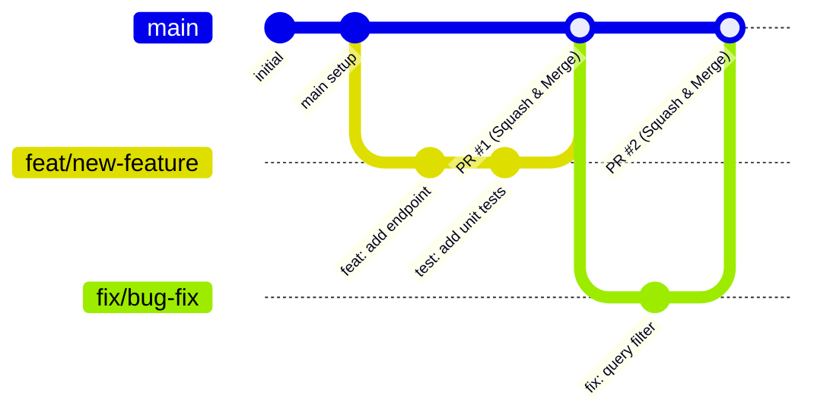

# workshop1

A collaborative project workspace containing backend (`api`) and frontend (`frontend`) services for **Restaurant Review Insights** — turning Google Maps reviews into actionable restaurant improvement suggestions.

---

## Table of Contents

- [Project Structure](#project-structure)
- [Collaborator Quick Start](#collaborator-quick-start)
  - [1. Backend Setup (`api`)](#1-backend-setup-api)
  - [2. Running Tests](#2-running-tests)
  - [3. Frontend Setup (`frontend`)](#3-frontend-setup-frontend)
- [Agentic & AI-Assisted Coding](#agentic--ai-assisted-coding)
- [Collaboration Guide](#collaboration-guide)
  - [Code of Conduct](#code-of-conduct)
  - [Git Collaboration Flow (For Invited Collaborators)](#git-collaboration-flow-for-invited-collaborators)
  - [Branching Strategy](#branching-strategy)
  - [Commit Message Conventions](#commit-message-conventions)
  - [Syncing & Rebasing](#syncing--rebasing)
  - [Submitting & Reviewing Pull Requests](#submitting--reviewing-pull-requests)
  - [External Contributors (Fork & PR)](#external-contributors-fork--pr)
- [Getting Help](#getting-help)

---

## Project Structure

```text
workshop1/
├── api/            # FastAPI backend (SQLite, SQLAlchemy, OpenAI review analytics)
├── frontend/       # Client-side web application
├── .github/        # GitHub PR template and workflows
├── AGENTS.md       # AI agent development guide & system prompt context
├── CLAUDE.md       # Claude Code CLI developer guide
├── CONTRIBUTING.md # Contributor guidelines index
└── README.md       # Project overview & collaboration guide
```

---

## Collaborator Quick Start

### 1. Backend Setup (`api`)

1. **Clone the repository:**
   ```bash
   git clone https://github.com/dan-tran-van/workshop1.git
   cd workshop1
   ```

2. **Create and activate a Python virtual environment:**
   ```bash
   cd api
   python3 -m venv .venv
   source .venv/bin/activate
   ```

3. **Install dependencies:**
   ```bash
   pip install -r requirements.txt
   ```

4. **Configure environment variables (optional):**
   ```bash
   cp .env.example .env
   ```
   *Note: If `OPENAI_API_KEY` is not provided, the API automatically falls back to an intelligent heuristic mock analyzer so you can develop completely offline without costs.*

5. **Seed the database with sample restaurants and reviews:**
   ```bash
   python seed.py
   ```

6. **Start the API server:**
   ```bash
   uvicorn app.main:app --reload --port 8000
   ```
   - Swagger Documentation: [http://localhost:8000/docs](http://localhost:8000/docs)
   - Alternative Docs (ReDoc): [http://localhost:8000/redoc](http://localhost:8000/redoc)

### 2. Running Tests

Always verify your changes before pushing or opening a PR:

```bash
# From within the api directory:
python -m unittest tests/test_api.py

# Or from the repository root:
./api/.venv/bin/python -m unittest api/tests/test_api.py
```

### 3. Frontend Setup (`frontend`)

*The frontend application workspace will be initialized in the `frontend/` directory.*

---

## Agentic & AI-Assisted Coding

This repository is optimized for collaboration with AI agents (Claude Code, Cursor, Copilot, Gemini CLI, etc.):

- **[AGENTS.md](AGENTS.md)**: Universal context and constraints for AI coding agents, including database schemas, architectural patterns, and testing rules.
- **[CLAUDE.md](CLAUDE.md)**: Tailored quick commands, style guidelines, and conventions for Anthropic's Claude Code CLI.

If you are using an AI coding assistant, direct it to read `AGENTS.md` or `CLAUDE.md` before making architectural changes.

---

## Collaboration Guide

We welcome contributions of all levels! To ensure a smooth development process and maintain high code quality, please follow the guidelines below.

### Code of Conduct

We are committed to providing a welcoming, inclusive, and harassment-free environment for everyone. Please treat all contributors and maintainers with respect, patience, and kindness.

---

### Git Collaboration Flow (For Invited Collaborators)

If you have been invited as a collaborator with direct push access to `dan-tran-van/workshop1`, **you do not need to fork**. Work directly on feature branches within the shared repository:



#### Step-by-Step Collaborator Workflow:

1. **Clone the repository directly:**
   ```bash
   git clone https://github.com/dan-tran-van/workshop1.git
   cd workshop1
   ```

2. **Always start from the latest `main`:**
   ```bash
   git checkout main
   git pull origin main
   ```

3. **Create a dedicated feature branch:**
   ```bash
   git checkout -b feat/your-feature-name
   ```
   *(Never commit directly to `main`)*

4. **Develop and run tests:**
   ```bash
   # Run tests to ensure nothing breaks
   ./api/.venv/bin/python -m unittest api/tests/test_api.py
   ```

5. **Commit using Conventional Commits:**
   ```bash
   git add .
   git commit -m "feat(api): add export endpoint for analysis"
   ```

6. **Rebase on `origin/main` before pushing:**
   To maintain a clean, linear Git history, rebase your branch on the latest `main`:
   ```bash
   git fetch origin
   git rebase origin/main
   ```
   *(If there are merge conflicts, resolve them and run `git rebase --continue`)*

7. **Push your branch directly to the repository:**
   ```bash
   git push -u origin feat/your-feature-name
   ```

8. **Open a Pull Request (PR):**
   - Go to [dan-tran-van/workshop1/pulls](https://github.com/dan-tran-van/workshop1/pulls).
   - Click **New pull request**.
   - Compare: `feat/your-feature-name` into `base: main`.
   - Fill out the PR template checklist and request reviews from team members.

9. **Review, Merge & Clean Up:**
   - Once approved and tests pass, merge the PR (Squash and Merge recommended).
   - Switch back to `main`, pull the merge, and delete your feature branch locally and remotely:
     ```bash
     git checkout main
     git pull origin main
     git branch -d feat/your-feature-name
     git push origin --delete feat/your-feature-name
     ```

---

### Branching Strategy

Name your branches with standard prefixes describing the intent:

| Prefix | Purpose | Example |
| :--- | :--- | :--- |
| `feat/` | New features or endpoints | `feat/user-auth`, `feat/export-csv` |
| `fix/` | Bug fixes and patches | `fix/db-connection-leak` |
| `docs/` | Documentation changes | `docs/update-collab-guide` |
| `refactor/` | Code refactoring without behavior change | `refactor/thin-router-handlers` |
| `test/` | Adding or updating tests | `test/analysis-unit-tests` |
| `chore/` | Dependency, build, or configuration updates | `chore/update-requirements` |

---

### Commit Message Conventions

We follow [Conventional Commits](https://www.conventionalcommits.org/):

```text
<type>(<optional scope>): <short description in present tense>

[optional bullet points or body]
```

**Common types:**
- `feat`: A new feature (e.g. `feat(api): add review search filter`)
- `fix`: A bug fix (e.g. `fix(api): handle missing place id gracefully`)
- `docs`: Documentation updates (e.g. `docs: update setup guide in README`)
- `refactor`: Refactoring code without functional changes
- `test`: Adding or improving tests
- `chore`: Tooling, dependencies, or repo config

---

### Submitting & Reviewing Pull Requests

- **Self-Review**: Run the test suite (`python -m unittest api/tests/test_api.py`) before opening the PR.
- **Link Issues**: Reference related issues in the PR description (e.g., `Closes #5`).
- **Peer Review**: At least one collaborator should review and approve before merging to `main`.
- **Merge Strategy**: Prefer **Squash and Merge** or **Rebase and Merge** to maintain a clean linear commit history on `main`.

---

### External Contributors (Fork & PR)

If you are not an invited collaborator on GitHub and do not have direct push access:
1. Fork the repo to your personal GitHub account.
2. Clone your fork locally and add the upstream remote (`git remote add upstream https://github.com/dan-tran-van/workshop1.git`).
3. Push to your fork and submit a PR from your fork's branch into `dan-tran-van/workshop1:main`.

---

## Getting Help

If you have questions or need help:
- Open a GitHub Issue with the `question` label.
- Reach out or mention maintainers in your Pull Request or Issue thread.
